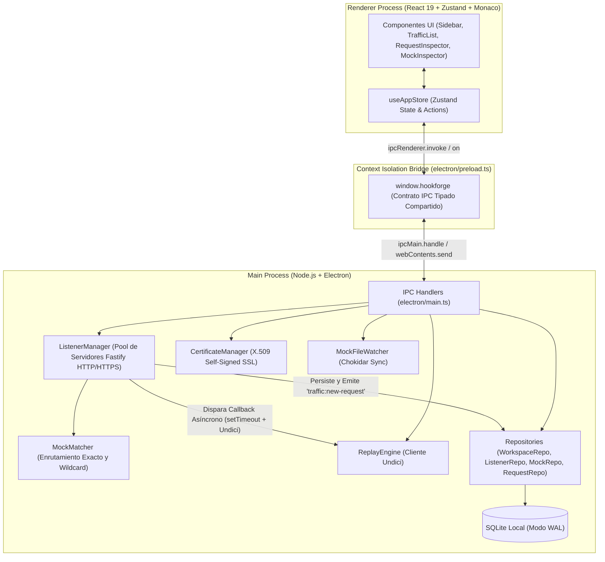

<p align="center">
  
</p>

<h1 align="center">🛠️ Hooksmith — Documentación Técnica y Guía de Arquitectura</h1>

<p align="center">
  <a href="https://github.com/claudsan/hooksmith/actions/workflows/ci.yml"></a>
  <a href="https://github.com/claudsan/hooksmith/actions/workflows/release.yml"></a>
  <a href="https://github.com/claudsan/hooksmith/actions/workflows/pages.yml"></a>
  
  
  
  
</p>

<p align="center">
  <a href="CONTRIBUTING.pt-BR.md">🇧🇷 Versão em Português</a> •
  <a href="CONTRIBUTING.md">🇺🇸 English Version</a> •
  <a href="CONTRIBUTING.es-ES.md">🇪🇸 Versión en Español</a> •
  <a href="README.es-ES.md">📖 Volver al Manual de Uso</a>
</p>

---

¡Bienvenido(a) a la documentación técnica oficial de **Hooksmith**! Este documento fue escrito para desarrolladores y arquitectos de software que desean comprender **qué tecnologías utilizamos**, **cómo diseñamos la arquitectura interna** y **cómo contribuir** con nuevas funcionalidades o integraciones de nuestro backlog (como Apache Kafka, RabbitMQ y Programación de Llamadas).

---

## 🧱 1. Stack Tecnológico (Qué usamos y por qué)

Hooksmith fue construido como una aplicación de escritorio nativa multiplataforma enfocada en **baja latencia**, **ejecución 100% local** y **aislamiento de contexto seguro**:

### Proceso Principal (Back-end Local / Node.js y Electron)
| Tecnología | Versión | Rol en la Arquitectura |
| :--- | :--- | :--- |
| **Electron** | `^33.0.0` | Runtime de escritorio multiplataforma, gestión de ventana frameless y puente IPC seguro (`contextBridge`). |
| **Fastify** | `^5.0.0` | Servidor HTTP/HTTPS de altísimo rendimiento utilizado para instanciar y destruir *Listeners* dinámicamente en puertos locales en tiempo de ejecución. |
| **better-sqlite3** | `^11.3.0` | Motor SQLite síncrono nativo en C++ configurado en modo **WAL (Write-Ahead Logging)** para escritura instantánea de tráfico sin bloqueo de E/S. |
| **Undici** | `^6.20.0` | Cliente HTTP/1.1 de baja latencia utilizado para Proxy Forwarding, **Replay Engine** y disparo de **Callbacks Asíncronos**, con soporte para certificados SSL autofirmados. |
| **selfsigned** | `^5.5.0` | Generación programática zero-config de certificados X.509 (`cert.pem` y `key.pem`) para puertos HTTPS locales. |
| **Chokidar** | `^3.6.0` | File watcher para sincronización bidireccional entre reglas de mock en la base de datos SQLite y archivos JSON locales del proyecto. |

### Proceso Renderer (Front-end / UI)
| Tecnología | Versión | Rol en la Arquitectura |
| :--- | :--- | :--- |
| **React** | `^19.0.0` | Biblioteca de interfaz con componentes funcionales, hooks personalizados de redimensionamiento y memoización de listas de tráfico. |
| **TypeScript** | `^5.6.0` | Tipado estricto de extremo a extremo, compartiendo contratos de datos (`electron/preload.ts` ↔ `src/types/ipc.ts`) entre Main y Renderer. |
| **Zustand** | `^5.0.0` | Gestión de estado global reactivo con selectores atómicos y suscripción a eventos IPC en tiempo real. |
| **Monaco Editor** | `^4.6.0` | El mismo motor de código de VS Code integrado para inspección, resaltado de sintaxis, plegado de código (code folding) y edición de payloads JSON/XML/HTML. |
| **Tailwind CSS** | `^3.4.14` | Sistema de diseño *Dark Forge* con tokens semánticos de color, superficie y tipografía (`Inter` + `JetBrains Mono`). |
| **i18next** | `^27.2.7` | Internacionalización reactiva completa en **Español (`es-ES`)**, **Portugués (`pt-BR`)** e **Inglés (`en-US`)**. |

---

## 🏛️ 2. Arquitectura del Sistema (Cómo construimos el proyecto)

La aplicación sigue los principios de **Clean Architecture**, **SOLID** y separación estricta de responsabilidades entre dos procesos aislados de Electron:



---

## 📂 3. Estructura de Directorios

```text
hooksmith/
├── electron/                      # Proceso Principal (Node.js / Electron Main)
│   ├── main.ts                    # Bootstrap de la app, ventana frameless y registro de canales IPC
│   ├── preload.ts                 # Puente seguro (contextBridge) exponiendo window.hookforge y tipos IPC
│   ├── core/                      # Motores de dominio
│   │   ├── CertificateManager.ts  # Emisión y caché local de certificados SSL autofirmados
│   │   ├── ListenerManager.ts     # Gestión dinámica de servidores Fastify por puerto
│   │   ├── MockMatcher.ts         # Algoritmo de coincidencia de rutas (exactas, prefijos y alcance de puerto)
│   │   ├── MockFileWatcher.ts     # Sincronización de reglas con archivo JSON local
│   │   └── ReplayEngine.ts        # Reenvío de peticiones HTTP/HTTPS con override de cabeceras/body
│   └── db/                        # Capa de Persistencia
│       ├── database.ts            # Inicialización de SQLite (WAL) y migraciones automáticas de esquema
│       └── repositories.ts        # Patrón Repository con consultas preparadas (Prepared Statements)
│
├── src/                           # Proceso Renderer (Front-end React 19)
│   ├── App.tsx                    # Diseño principal en 3 columnas redimensionables
│   ├── components/
│   │   ├── inspector/             # RequestInspector, MockInspector, PayloadViewer, ReplayBar, CodeEditor
│   │   ├── layout/                # TitleBar, Sidebar, StatusBar, LanguageToggle y Modales
│   │   ├── traffic/               # TrafficList y TrafficItem (stream en tiempo real)
│   │   └── ui/                    # Design System (Badges, Button, ConfirmModal, Flags SVG, ResizeHandle, Toggle)
│   ├── hooks/                     # useAppLifecycle, useResizableWidth, useResizableHeight, useNow
│   ├── i18n/                      # Diccionarios ptBR.ts, enUS.ts y esES.ts
│   ├── lib/                       # Utilidades HTTP, formato de fecha/hora, prettify JSON y generador cURL
│   ├── store/                     # useAppStore.ts (Zustand Store)
│   └── theme/                     # Configuración personalizada del tema oscuro en Monaco Editor
│
└── docs/                          # Sitio oficial estático (GitHub Pages) con simulador interactivo
```

---

## ⚙️ 4. Flujos Internos Principales

### 4.1. Ciclo de Vida de una Petición Interceptada (`ListenerManager.ts`)
1. Cuando se activa un listener en el puerto `:PORT`, `ListenerManager` crea una instancia Fastify dedicada (inyectando `key` y `cert` de `CertificateManager` si `is_https === 1`).
2. Un *content-type parser* comodín (`*`) captura el `Buffer` crudo de la petición sin alterar los bytes (esencial para validación de firmas HMAC como Stripe o GitHub).
3. `MockMatcher` evalúa las reglas activas (`enabled = 1`) del workspace actual, priorizando reglas vinculadas específicamente a ese puerto (`listener_port`) sobre reglas globales (`listener_port IS NULL`).
4. **Si hay coincidencia de Mock:**
   - Aplica el retraso simulado (`delay_ms`) si está configurado.
   - Registra la petición en SQLite con `source_type = 'MOCKED'` y emite el evento IPC `traffic:new-request` hacia la interfaz.
   - **Si la regla tiene Callback Asíncrono (`callback_url`):** programa mediante un temporizador no bloqueante el disparo HTTP con `Undici` tras `callback_delay_ms`, guardando el resultado del callback en la base de datos con `source_type = 'CALLBACK'` para que el desarrollador también vea la respuesta de su backend en el panel.
5. **Si no hay coincidencia de Mock:** responde localmente con estado predeterminado `200 OK` (`{"status": "captured_by_hooksmith"}`) y registra con `source_type = 'CAPTURED'`.

### 4.2. Base de Datos SQLite y Migraciones Automáticas (`database.ts`)
La base de datos SQLite utiliza `PRAGMA journal_mode = WAL` y `PRAGMA foreign_keys = ON`. Las tablas principales son:
- **`workspaces`**: Agrupación lógica de proyectos.
- **`listeners`**: Puertos configurados (`port`, `name`, `is_active`, `is_https`).
- **`mock_rules`**: Reglas de simulación (`listener_port`, `method`, `path`, `status_code`, `delay_ms`, `response_headers_json`, `response_body`, `callback_url`, `callback_method`, `callback_body`, `callback_delay_ms`).
- **`captured_requests`**: Historial de tráfico con índice compuesto `idx_requests_workspace_created` para consultas instantáneas.

> **Nota sobre Migraciones:** El método `initializeSchema()` en `electron/db/database.ts` inspecciona `PRAGMA table_info(...)` al iniciar para añadir nuevas columnas de forma idempotente sin romper bases de datos existentes.

---

## 💻 5. Cómo Ejecutar el Proyecto Localmente

### Requisitos Previos
- **Node.js** `>= 20.x` (recomendado `22.x`)
- **npm** `>= 10.x`
- Herramientas de compilación nativas del sistema (en caso de que `better-sqlite3` necesite recompilarse para el ABI de Electron).

### Paso a Paso
```bash
# 1. Clona el repositorio
git clone https://github.com/claudsan/hooksmith.git
cd hooksmith

# 2. Instala las dependencias
npm install

# 3. Compila el proceso Electron (TypeScript -> dist-electron) e inicia el entorno de desarrollo (Vite + Electron)
npm run build
npm run dev
```

### Scripts Disponibles en `package.json`
- `npm run dev`: Inicia simultáneamente el servidor Vite (`http://localhost:5173`) y la ventana de Electron con Hot Reload.
- `npm run typecheck`: Ejecuta la validación completa de TypeScript tanto para el Renderer (`tsconfig.json`) como para el Main Process (`tsconfig.node.json`).
- `npm run build`: Compila TypeScript, genera el bundle optimizado de Vite en `dist/` y transpila el código de Electron en `dist-electron/`.

---

## 🔮 6. Guía para Contribuir al Backlog (Kafka, RabbitMQ y Cron)

¿Quieres ayudar a construir las próximas grandes funcionalidades de Hooksmith? Así se integra cada nuevo módulo en nuestra arquitectura:

1. **📡 Integración con Apache Kafka:**
   - Crear `electron/core/KafkaManager.ts` gestionando conexiones de consumidor/productor.
   - Añadir canales IPC en `electron/main.ts` y `electron/preload.ts`.
   - Permitir que una `MockRule` o listener reenvíe el payload recibido hacia un tópico Kafka local.
2. **🐇 Integración con RabbitMQ (AMQP):**
   - Crear `electron/core/RabbitManager.ts` para conexión con exchanges y colas locales, lectura de mensajes y publicación desde mocks/replays.
3. **⏰ Programación de Llamadas (Cron Scheduler):**
   - Crear `electron/core/ScheduleManager.ts` persistiendo tareas programadas en SQLite y disparando llamadas mediante `ReplayEngine` con registro automático en `Live Traffic`.

### Flujo de Pull Request
1. Haz un **Fork** del proyecto y crea tu rama (`git checkout -b feat/mi-funcionalidad`).
2. Asegúrate de que el tipado y la compilación pasen sin errores:
   ```bash
   npm run typecheck && npm run build
   ```
3. Si añades nuevos textos en la interfaz, incluye las claves correspondientes en los 3 idiomas dentro de `src/i18n/locales/` (`ptBR.ts`, `enUS.ts`, `esES.ts`).
4. ¡Abre tu **Pull Request** detallando el problema resuelto o la funcionalidad añadida!
