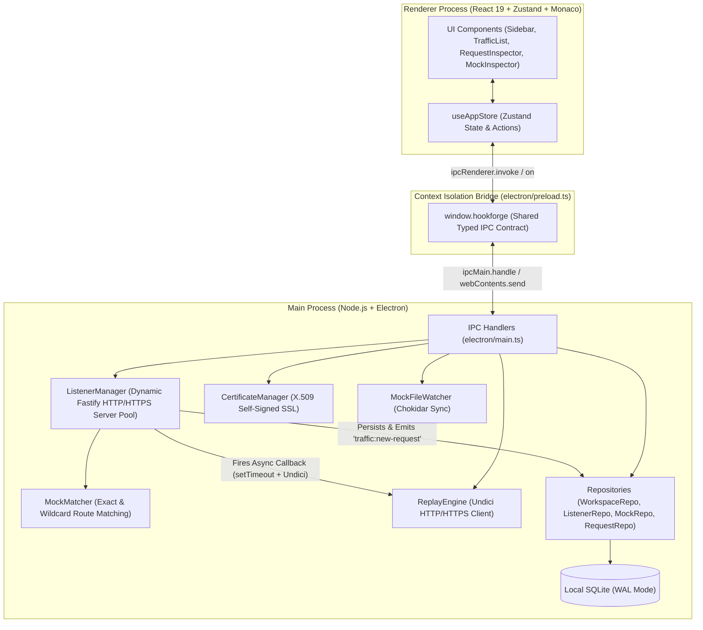

<p align="center">
  
</p>

<h1 align="center">🛠️ Hooksmith — Technical Documentation & Architecture Guide</h1>

<p align="center">
  <a href="CONTRIBUTING.pt-BR.md">🇧🇷 Versão em Português</a> •
  <a href="CONTRIBUTING.md">🇺🇸 English Version</a> •
  <a href="README.md">📖 Back to User Manual</a>
</p>

---

Welcome to the official technical documentation of **Hooksmith**! This guide is written for software engineers and contributors who want to understand **what technologies we use**, **how the internal architecture is designed**, and **how to contribute** new features or backlog integrations (such as Apache Kafka, RabbitMQ, and Scheduled Calls).

---

## 🧱 1. Tech Stack (What We Use & Why)

Hooksmith is built as a native cross-platform desktop application engineered for **low latency**, **100% local execution**, and **strict context isolation**:

### Main Process (Local Backend / Node.js & Electron)
| Technology | Version | Architectural Role |
| :--- | :--- | :--- |
| **Electron** | `^33.0.0` | Cross-platform desktop runtime, frameless window management, and secure IPC bridge (`contextBridge`). |
| **Fastify** | `^5.0.0` | High-performance HTTP/HTTPS server engine used to dynamically spawn and tear down local port *Listeners* at runtime. |
| **better-sqlite3** | `^11.3.0` | Native C++ synchronous SQLite engine configured in **WAL (Write-Ahead Logging)** mode for zero-bottleneck traffic persistence. |
| **Undici** | `^6.20.0` | Low-latency HTTP/1.1 client powering Proxy Forwarding, the **Replay Engine**, and **Asynchronous Webhook Callbacks**, supporting local self-signed SSL certificates. |
| **selfsigned** | `^5.5.0` | Zero-config programmatic X.509 certificate generation (`cert.pem` & `key.pem`) for local HTTPS listeners. |
| **Chokidar** | `^3.6.0` | File system watcher enabling bidirectional sync between SQLite mock rules and local workspace JSON files. |

### Renderer Process (Frontend / UI)
| Technology | Version | Architectural Role |
| :--- | :--- | :--- |
| **React** | `^19.0.0` | Declarative UI layer with custom resizable split hooks and memoized traffic stream rendering. |
| **TypeScript** | `^5.6.0` | End-to-end strict typing, sharing IPC data contracts (`electron/preload.ts` ↔ `src/types/ipc.ts`) across Main and Renderer. |
| **Zustand** | `^5.0.0` | Reactive state management with atomic selectors and real-time IPC event subscriptions. |
| **Monaco Editor** | `^4.6.0` | VS Code's code editor embedded for syntax highlighting, code folding, and editing JSON/XML/HTML payloads. |
| **Tailwind CSS** | `^3.4.14` | *Dark Forge* design system with semantic surface, border, and typography tokens (`Inter` + `JetBrains Mono`). |
| **i18next** | `^27.2.7` | Full reactive internationalization across **English (`en-US`)**, **Portuguese (`pt-BR`)**, and **Spanish (`es-ES`)**. |

---

## 🏛️ 2. System Architecture (How We Built It)

Hooksmith follows **Clean Architecture** and **SOLID** principles with a strict boundary between Electron's Main Process and the React Renderer Process:



---

## 📂 3. Directory Structure

```text
hooksmith/
├── electron/                      # Main Process (Node.js / Electron Main)
│   ├── main.ts                    # App bootstrap, frameless window & IPC channel registration
│   ├── preload.ts                 # Secure contextBridge exposing window.hookforge & shared types
│   ├── core/                      # Domain Engines
│   │   ├── CertificateManager.ts  # Local X.509 self-signed SSL certificate generation & cache
│   │   ├── ListenerManager.ts     # Dynamic Fastify server lifecycle per port
│   │   ├── MockMatcher.ts         # Route matching engine (exact, wildcard prefix & port scope)
│   │   ├── MockFileWatcher.ts     # Bilateral sync with local workspace JSON file
│   │   └── ReplayEngine.ts        # Request replay engine with header/body overrides
│   └── db/                        # Persistence Layer
│       ├── database.ts            # SQLite initialization (WAL mode) & idempotent schema migrations
│       └── repositories.ts        # Repository pattern using prepared statements
│
├── src/                           # Renderer Process (React 19 Frontend)
│   ├── App.tsx                    # 3-column resizable workspace layout
│   ├── components/
│   │   ├── inspector/             # RequestInspector, MockInspector, PayloadViewer, ReplayBar, CodeEditor
│   │   ├── layout/                # TitleBar, Sidebar, StatusBar, LanguageToggle & Modals
│   │   ├── traffic/               # TrafficList & TrafficItem (real-time stream)
│   │   └── ui/                    # Design System (Badges, Button, ConfirmModal, SVG Flags, ResizeHandle, Toggle)
│   ├── hooks/                     # useAppLifecycle, useResizableWidth, useResizableHeight, useNow
│   ├── i18n/                      # Locale dictionaries (ptBR.ts, enUS.ts, esES.ts)
│   ├── lib/                       # HTTP helpers, date/time formatters, JSON prettify & cURL generator
│   ├── store/                     # useAppStore.ts (Zustand Store)
│   └── theme/                     # Custom Dark Forge theme for Monaco Editor
│
└── docs/                          # Official static website (GitHub Pages) with interactive simulator
```

---

## ⚙️ 4. Core Internal Workflows

### 4.1. Intercepted Request Lifecycle (`ListenerManager.ts`)
1. When a listener is started on `:PORT`, `ListenerManager` spawns a dedicated Fastify instance (injecting `key` and `cert` from `CertificateManager` if `is_https === 1`).
2. A wildcard content-type parser (`*`) collects the raw request `Buffer` without mutating byte formatting (critical for HMAC webhook signature verification like Stripe or GitHub).
3. `MockMatcher` evaluates active rules (`enabled = 1`) for the workspace, prioritizing port-specific rules (`listener_port = :PORT`) over global rules (`listener_port IS NULL`).
4. **If a Mock Rule matches:**
   - Applies simulated latency (`delay_ms`) if configured.
   - Persists the captured request in SQLite with `source_type = 'MOCKED'` and emits `traffic:new-request` over IPC to the UI.
   - **If an Asynchronous Callback (`callback_url`) is configured on the rule:** schedules a non-blocking timer after `callback_delay_ms` that dispatches the callback via `Undici` and records the callback execution in SQLite with `source_type = 'CALLBACK'`, giving full visibility into the backend's response!
5. **If no Mock Rule matches:** responds locally with `200 OK` (`{"status": "captured_by_hooksmith"}`) and records the call with `source_type = 'CAPTURED'`.

### 4.2. SQLite Database & Automatic Migrations (`database.ts`)
The SQLite database runs with `PRAGMA journal_mode = WAL` and `PRAGMA foreign_keys = ON`. Core tables:
- **`workspaces`**: Logical project isolation.
- **`listeners`**: Configured ports (`port`, `name`, `is_active`, `is_https`).
- **`mock_rules`**: Simulation rules (`listener_port`, `method`, `path`, `status_code`, `delay_ms`, `response_headers_json`, `response_body`, `callback_url`, `callback_method`, `callback_body`, `callback_delay_ms`).
- **`captured_requests`**: Traffic history indexed by `idx_requests_workspace_created`.

> **Schema Migrations:** `initializeSchema()` in `electron/db/database.ts` inspects `PRAGMA table_info(...)` on startup to add new columns idempotently without breaking existing user databases.

---

## 💻 5. Local Development Setup

### Prerequisites
- **Node.js** `>= 20.x` (`22.x` recommended)
- **npm** `>= 10.x`
- Native build tools (if `better-sqlite3` needs to rebuild for your Electron ABI).

### Step-by-Step
```bash
# 1. Clone the repository
git clone https://github.com/claudsan/hooksmith.git
cd hooksmith

# 2. Install dependencies
npm install

# 3. Build the Electron main process and start the development environment (Vite + Electron)
npm run build
npm run dev
```

### Available Scripts (`package.json`)
- `npm run dev`: Concurrently starts the Vite dev server (`http://localhost:5173`) and launches Electron with Hot Reload.
- `npm run typecheck`: Runs full TypeScript verification across both Renderer (`tsconfig.json`) and Main Process (`tsconfig.node.json`).
- `npm run build`: Compiles TypeScript, bundles the frontend into `dist/`, and outputs the Electron main process into `dist-electron/`.

---

## 🔮 6. Contributing to the Backlog (Kafka, RabbitMQ & Cron)

Want to help build Hooksmith's upcoming roadmap integrations? Here is where each module fits in our architecture:

1. **📡 Apache Kafka Integration:**
   - Create `electron/core/KafkaManager.ts` managing producer/consumer clients.
   - Register typed IPC channels in `electron/main.ts` and `electron/preload.ts`.
   - Allow a `MockRule` or listener to bridge incoming HTTP webhooks directly into a Kafka topic.
2. **🐇 RabbitMQ (AMQP) Integration:**
   - Create `electron/core/RabbitManager.ts` to inspect queues/exchanges, read messages, and publish payloads from mock rules or replays.
3. **⏰ Scheduled Calls (Cron Scheduler):**
   - Create `electron/core/ScheduleManager.ts` persisting scheduled jobs in SQLite and triggering requests through `ReplayEngine` with automatic logging in `Live Traffic`.

### Pull Request Workflow
1. **Fork** the repository and create your feature branch (`git checkout -b feat/my-feature`).
2. Ensure typechecking and production build succeed with zero errors:
   ```bash
   npm run typecheck && npm run build
   ```
3. When adding new UI strings, add the corresponding translation keys to all 3 locale files in `src/i18n/locales/` (`ptBR.ts`, `enUS.ts`, `esES.ts`).
4. Open a **Pull Request** describing your changes!
