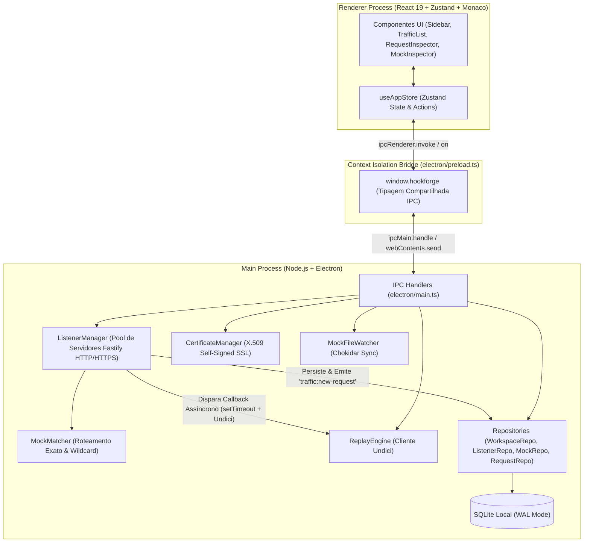

<p align="center">
  
</p>

<h1 align="center">🛠️ Hooksmith — Documentação Técnica & Guia de Arquitetura</h1>

<p align="center">
  <a href="CONTRIBUTING.pt-BR.md">🇧🇷 Versão em Português</a> •
  <a href="CONTRIBUTING.md">🇺🇸 English Version</a> •
  <a href="README.pt-BR.md">📖 Voltar ao Manual de Uso</a>
</p>

---

Bem-vindo(a) à documentação técnica oficial do **Hooksmith**! Este documento foi escrito para desenvolvedores e arquitetos de software que desejam entender **o que usamos**, **como projetamos a arquitetura interna** e **como contribuir** com novas funcionalidades ou integrações do nosso backlog (como Apache Kafka, RabbitMQ e Agendamento de Chamadas).

---

## 🧱 1. Stack Tecnológica (O que usamos e por quê)

O Hooksmith foi construído como uma aplicação desktop nativa multiplataforma focada em **baixa latência**, **execução 100% local** e **isolamento de contexto seguro**:

### Processo Principal (Back-end Local / Node.js & Electron)
| Tecnologia | Versão | Papel na Arquitetura |
| :--- | :--- | :--- |
| **Electron** | `^33.0.0` | Runtime desktop multiplataforma, gerenciamento de janela frameless e ponte IPC segura (`contextBridge`). |
| **Fastify** | `^5.0.0` | Servidor HTTP/HTTPS de altíssima performance usado para instanciar e destruir *Listeners* dinamicamente em portas locais em tempo de execução. |
| **better-sqlite3** | `^11.3.0` | Engine SQLite síncrona nativa em C++ configurada em modo **WAL (Write-Ahead Logging)** para gravação instantânea de tráfego sem bloqueio de I/O. |
| **Undici** | `^6.20.0` | Cliente HTTP/1.1 de baixa latência utilizado para Proxy Forwarding, **Replay Engine** e disparo de **Callbacks Assíncronos**, com suporte a certificados SSL auto-assinados. |
| **selfsigned** | `^5.5.0` | Geração programática zero-config de certificados X.509 (`cert.pem` e `key.pem`) para portas HTTPS locais. |
| **Chokidar** | `^3.6.0` | File watcher para sincronização bidirecional entre regras de mock no banco SQLite e arquivos locais do projeto. |

### Processo Renderer (Front-end / UI)
| Tecnologia | Versão | Papel na Arquitetura |
| :--- | :--- | :--- |
| **React** | `^19.0.0` | Biblioteca de interface com componentes funcionais, hooks customizados de redimensionamento e memoização de listas de tráfego. |
| **TypeScript** | `^5.6.0` | Tipagem estrita ponta a ponta, compartilhando contratos de dados (`electron/preload.ts` ↔ `src/types/ipc.ts`) entre Main e Renderer. |
| **Zustand** | `^5.0.0` | Gerenciamento de estado global reativo com seletores atômicos e assinatura de eventos IPC em tempo real. |
| **Monaco Editor** | `^4.6.0` | O mesmo motor de código do VS Code embarcado para inspeção, syntax highlighting, code folding e edição de payloads JSON/XML/HTML. |
| **Tailwind CSS** | `^3.4.14` | Sistema de design *Dark Forge* com tokens semânticos de cor, superfície e tipografia (`Inter` + `JetBrains Mono`). |
| **i18next** | `^27.2.7` | Internacionalização reativa completa nos idiomas **Português (`pt-BR`)**, **Inglês (`en-US`)** e **Espanhol (`es-ES`)**. |

---

## 🏛️ 2. Arquitetura do Sistema (Como fizemos o projeto)

A aplicação segue os princípios de **Clean Architecture**, **SOLID** e separação estrita de responsabilidades entre dois processos isolados do Electron:



---

## 📂 3. Estrutura de Diretórios

```text
hooksmith/
├── electron/                      # Processo Principal (Node.js / Electron Main)
│   ├── main.ts                    # Bootstrap do app, janela frameless e registro de canais IPC
│   ├── preload.ts                 # Ponte segura (contextBridge) expondo window.hookforge e tipos IPC
│   ├── core/                      # Motores de domínio
│   │   ├── CertificateManager.ts  # Emissão e cache local de certificados SSL auto-assinados
│   │   ├── ListenerManager.ts     # Gerenciamento dinâmico de servidores Fastify por porta
│   │   ├── MockMatcher.ts         # Algoritmo de matching de rotas (exatas, prefixos e escopo de porta)
│   │   ├── MockFileWatcher.ts     # Sincronização de regras com arquivo JSON local
│   │   └── ReplayEngine.ts        # Reenvio de requisições HTTP/HTTPS com override de headers/body
│   └── db/                        # Camada de Persistência
│       ├── database.ts            # Inicialização do SQLite (WAL) e migrações automáticas de schema
│       └── repositories.ts        # Padrão Repository com queries preparadas (Prepared Statements)
│
├── src/                           # Processo Renderer (Front-end React 19)
│   ├── App.tsx                    # Layout principal em 3 colunas redimensionáveis
│   ├── components/
│   │   ├── inspector/             # RequestInspector, MockInspector, PayloadViewer, ReplayBar, CodeEditor
│   │   ├── layout/                # TitleBar, Sidebar, StatusBar, LanguageToggle e Modais
│   │   ├── traffic/               # TrafficList e TrafficItem (stream em tempo real)
│   │   └── ui/                    # Design System (Badges, Button, ConfirmModal, Flags SVG, ResizeHandle, Toggle)
│   ├── hooks/                     # useAppLifecycle, useResizableWidth, useResizableHeight, useNow
│   ├── i18n/                      # Dicionários ptBR.ts, enUS.ts e esES.ts
│   ├── lib/                       # Utilitários HTTP, formatação de data/hora, prettify JSON e cURL builder
│   ├── store/                     # useAppStore.ts (Zustand Store)
│   └── theme/                     # Configuração customizada do tema escuro no Monaco Editor
│
└── docs/                          # Site oficial estático (GitHub Pages) com simulador interativo
```

---

## ⚙️ 4. Fluxos Internos Principais

### 4.1. Ciclo de Vida de uma Requisição Interceptada (`ListenerManager.ts`)
1. Quando um listener é ativado na porta `:PORT`, o `ListenerManager` cria uma instância Fastify dedicada (injetando `key` e `cert` do `CertificateManager` caso `is_https === 1`).
2. Um *content-type parser* coringa (`*`) captura o `Buffer` bruto da requisição sem corromper assinaturas de webhook (essencial para validação HMAC como Stripe/GitHub).
3. O `MockMatcher` avalia as regras ativas (`enabled = 1`) do workspace atual, priorizando regras vinculadas especificamente àquela porta (`listener_port`) sobre regras globais (`listener_port IS NULL`).
4. **Se houver match de Mock:**
   - Aplica o atraso simulado (`delay_ms`) se configurado.
   - Registra a requisição no SQLite com `source_type = 'MOCKED'` e emite o evento IPC `traffic:new-request` para a UI.
   - **Se a regra possuir Callback Assíncrono (`callback_url`):** agenda via timer não-bloqueante o disparo HTTP com `Undici` após `callback_delay_ms`, gravando o resultado do callback no banco com `source_type = 'CALLBACK'` para que o desenvolvedor também veja o retorno do seu backend no painel!
5. **Se não houver match de Mock:** responde localmente com status padrão `200 OK` (`{"status": "captured_by_hooksmith"}`) e grava com `source_type = 'CAPTURED'`.

### 4.2. Banco de Dados SQLite e Migrações Automáticas (`database.ts`)
O banco SQLite utiliza `PRAGMA journal_mode = WAL` e `PRAGMA foreign_keys = ON`. As tabelas principais são:
- **`workspaces`**: Agrupamento lógico de projetos.
- **`listeners`**: Portas configuradas (`port`, `name`, `is_active`, `is_https`).
- **`mock_rules`**: Regras de simulação (`listener_port`, `method`, `path`, `status_code`, `delay_ms`, `response_headers_json`, `response_body`, `callback_url`, `callback_method`, `callback_body`, `callback_delay_ms`).
- **`captured_requests`**: Histórico de tráfego com índice composto `idx_requests_workspace_created` para consultas instantâneas.

> **Nota sobre Migrações:** O método `initializeSchema()` em `electron/db/database.ts` inspeciona `PRAGMA table_info(...)` na inicialização para adicionar novas colunas de forma idempotente sem quebrar bancos existentes de usuários.

---

## 💻 5. Como Rodar o Projeto Localmente

### Pré-requisitos
- **Node.js** `>= 20.x` (recomendado `22.x`)
- **npm** `>= 10.x`
- Ferramentas de build nativas do sistema (caso o `better-sqlite3` precise recompilar para o ABI do Electron).

### Passo a Passo
```bash
# 1. Clone o repositório
git clone https://github.com/claudsan/hooksmith.git
cd hooksmith

# 2. Instale as dependências
npm install

# 3. Compile o processo Electron (TypeScript -> dist-electron) e inicie o ambiente dev (Vite + Electron)
npm run build
npm run dev
```

### Scripts Disponíveis no `package.json`
- `npm run dev`: Inicia simultaneamente o servidor Vite (`http://localhost:5173`) e a janela do Electron com Hot Reload.
- `npm run typecheck`: Executa a validação completa do TypeScript tanto para o Renderer (`tsconfig.json`) quanto para o Main Process (`tsconfig.node.json`).
- `npm run build`: Compila o TypeScript, gera o bundle otimizado do Vite em `dist/` e transpila o código do Electron para `dist-electron/`.

---

## 🔮 6. Guia para Contribuir no Backlog (Kafka, RabbitMQ e Cron)

Quer ajudar a construir as próximas grandes features do Hooksmith? Veja onde cada módulo novo se encaixa na nossa arquitetura:

1. **📡 Integração com Apache Kafka:**
   - Criar `electron/core/KafkaManager.ts` gerenciando conexões de consumidor/produtor.
   - Adicionar canais IPC em `electron/main.ts` e `electron/preload.ts`.
   - Permitir que uma `MockRule` ou listener encaminhe o payload recebido para um tópico Kafka local.
2. **🐇 Integração com RabbitMQ (AMQP):**
   - Criar `electron/core/RabbitManager.ts` para conexão com exchanges e filas locais, leitura de mensagens e publicação a partir de mocks/replays.
3. **⏰ Agendamento de Chamadas (Cron Scheduler):**
   - Criar `electron/core/ScheduleManager.ts` persistindo jobs agendados no SQLite e disparando chamadas via `ReplayEngine` com registro automático no `Live Traffic`.

### Fluxo de Pull Request
1. Faça um **Fork** do projeto e crie sua branch (`git checkout -b feat/minha-feature`).
2. Garanta que a tipagem e o build estão passando sem erros:
   ```bash
   npm run typecheck && npm run build
   ```
3. Se adicionar novos textos na interface, adicione as chaves correspondentes nos 3 idiomas em `src/i18n/locales/` (`ptBR.ts`, `enUS.ts`, `esES.ts`).
4. Abra seu **Pull Request** detalhando o problema resolvido ou a funcionalidade adicionada!
